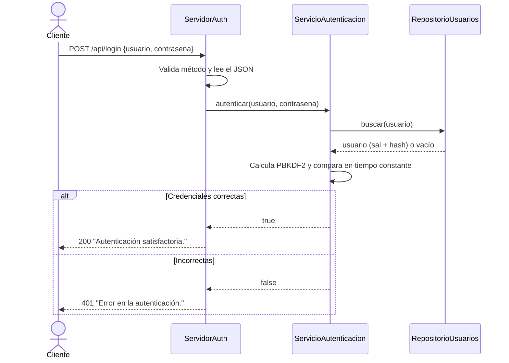
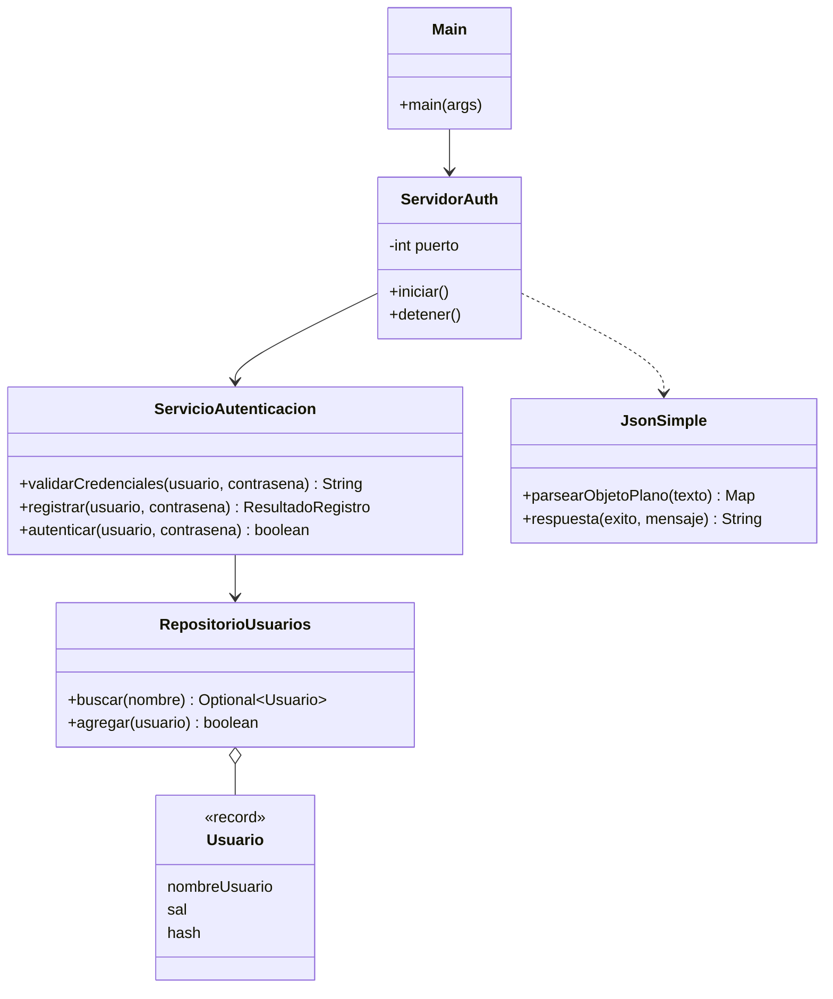

# Servicio web de registro e inicio de sesión (Java)

Evidencia **AA5-EV01 – Diseño y desarrollo de servicios web**.
Servicio REST que **registra usuarios** y **autentica** a quien envía un usuario y una contraseña:

- Si las credenciales son correctas responde **"Autenticación satisfactoria."**
- Si no lo son responde **"Error en la autenticación."**

Está hecho solo con el JDK (servidor `com.sun.net.httpserver`), sin librerías externas.

## Requisitos

- JDK 17 o superior. Comprobar con `javac -version`.
  En Linux Mint: `sudo apt install openjdk-17-jdk`

## Ejecutar

```bash
./scripts/ejecutar.sh          # compila y arranca en http://localhost:8080
./scripts/ejecutar.sh 9000     # o en otro puerto
```

Para solo compilar: `./scripts/compilar.sh`

## Probar

Con el servicio corriendo, en otra terminal:

```bash
./scripts/probar.sh
```

Ejecuta 10 pruebas (registro, duplicado, validaciones, login correcto e incorrecto, JSON mal formado...).
También se puede probar con Postman o con `curl` manualmente (ver abajo).

## Diseño del servicio

### Contrato de la API

Todas las respuestas son JSON con la forma `{"exito": true|false, "mensaje": "..."}`.

| Método | Ruta            | Descripción                  | Cuerpo de la petición                         |
|--------|-----------------|------------------------------|-----------------------------------------------|
| POST   | `/api/registro` | Crea un usuario nuevo        | `{"usuario":"ana","contrasena":"clave123"}`   |
| POST   | `/api/login`    | Comprueba usuario y clave    | `{"usuario":"ana","contrasena":"clave123"}`   |
| GET    | `/api/salud`    | Indica que el servicio vive  | (sin cuerpo)                                  |

### Códigos de respuesta

| Código | Cuándo                                                              | Mensaje                                        |
|--------|---------------------------------------------------------------------|------------------------------------------------|
| 200    | Login correcto                                                      | Autenticación satisfactoria.                   |
| 201    | Registro correcto                                                   | Registro exitoso.                              |
| 400    | Datos inválidos, campos faltantes o JSON mal formado                | Explica qué está mal                           |
| 401    | Usuario inexistente **o** contraseña incorrecta                     | Error en la autenticación.                     |
| 405    | Método HTTP no permitido en esa ruta                                | Método no permitido.                           |
| 409    | El usuario ya está registrado                                       | El usuario ya existe.                          |
| 413    | Cuerpo de la petición mayor a 4 KB                                  | La petición es demasiado grande.               |
| 500    | Error inesperado del servidor                                       | Error interno del servidor.                    |

### Reglas de validación

- `usuario`: de 3 a 50 caracteres entre letras, números, `.`, `_`, `@` y `-`. No distingue mayúsculas.
- `contrasena`: de 6 a 100 caracteres.

### Ejemplos con curl

```bash
# Registrar
curl -X POST http://localhost:8080/api/registro \
     -H 'Content-Type: application/json' \
     -d '{"usuario":"ana","contrasena":"clave123"}'
# {"exito":true,"mensaje":"Registro exitoso."}

# Login correcto
curl -X POST http://localhost:8080/api/login \
     -H 'Content-Type: application/json' \
     -d '{"usuario":"ana","contrasena":"clave123"}'
# {"exito":true,"mensaje":"Autenticación satisfactoria."}

# Login incorrecto
curl -X POST http://localhost:8080/api/login \
     -H 'Content-Type: application/json' \
     -d '{"usuario":"ana","contrasena":"mala"}'
# {"exito":false,"mensaje":"Error en la autenticación."}
```

### Flujo del inicio de sesión



### Clases



### Estructura del proyecto

```
proyecto/
├── src/main/java/com/antobano/auth/
│   ├── Main.java                   Arranque de la aplicación
│   ├── ServidorAuth.java           Servidor HTTP y endpoints
│   ├── ServicioAutenticacion.java  Registro, validación y autenticación
│   ├── RepositorioUsuarios.java    Guardado y búsqueda de usuarios
│   ├── Usuario.java                Modelo de datos
│   └── JsonSimple.java             Lectura y escritura de JSON
├── scripts/                        compilar.sh, ejecutar.sh, probar.sh
├── .gitignore
└── README.md
```

## Decisiones de seguridad

- **Las contraseñas nunca se guardan en texto plano.** Se almacena un hash PBKDF2-HMAC-SHA256 (120 000 iteraciones) con una sal aleatoria distinta por usuario.
- **Comparación en tiempo constante** y mismo mensaje de error si falla el usuario o la contraseña, para no revelar qué usuarios existen.
- **Validación de entradas**, límite de tamaño de petición y errores internos sin datos técnicos.
- Los usuarios se guardan en `datos/usuarios.csv` (ignorado por git).

## Limitaciones (alcance de un inicio de sesión básico)

- No genera token ni sesión: solo confirma si la autenticación fue correcta.
- Usa HTTP sin cifrar; en producción debería ir detrás de HTTPS.
- Sin límite de intentos fallidos ni recuperación de contraseña.

## Versionamiento

El proyecto se versiona con **Git** (rama `main`) con commits pequeños que siguen el formato
`tipo: descripción` (`feat`, `docs`, `chore`).
